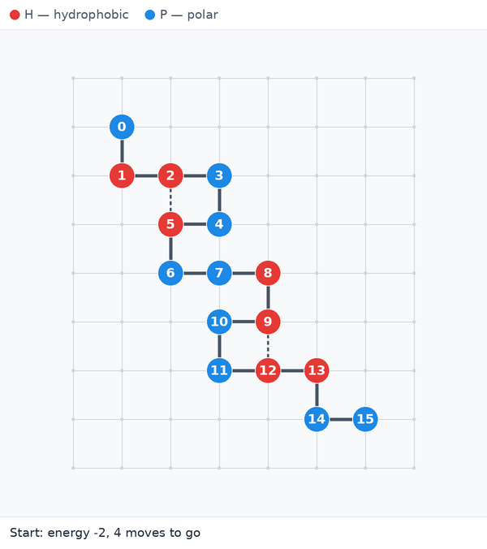

# hpfold — Decoy discriminator per il modello HP 2D


Modello di machine learning che, data una **sequenza HP** e una sua **conformazione** su reticolo quadrato 2D, dice se la conformazione è **nativa** (energia minima per quella sequenza) oppure un **decoy**.

Il dataset di addestramento è generato dal progetto stesso: per migliaia di sequenze casuali si esegue il **Replica Exchange Monte Carlo** (REMC, variante `REMC_m` di Thachuk et al., 2007, con mosse VSHD e pull moves) e si raccolgono conformazioni native e decoy, bilanciate 1:1 e divise in fasce di difficoltà. 
Il modello principale è una **GNN** sul grafo dei contatti della conformazione affiancata da una **CNN 1D** sulla sequenza, confrontata con tre baseline più semplici.

Il calcolo pesante (simulazione, enumerazione esatta, grafo delle mosse) è in C++17 ed è esposto a Python con pybind11; la pipeline, il dataset, il modello (PyTorch) e la GUI (Tkinter) sono in Python.

<p align="center">
  
</p>

## Indice

- [Come funziona](#come-funziona)
- [Struttura del repository](#struttura-del-repository)
- [Requisiti e dipendenze](#requisiti-e-dipendenze)
- [Installazione e build](#installazione-e-build)
- [Comandi da terminale per l'esecuzione](#comandi-da-terminale-per-lesecuzione)
  - [Training](#training)
  - [Score di una conformazione (esempio)](#score-di-una-conformazione-esempio)
  - [Uso da Python](#uso-da-python)
- [Configurazione](#configurazione)
- [Risultati](#risultati)
- [Roadmap e limitazioni note](#roadmap-e-limitazioni-note)
- [Riferimenti](#riferimenti)

## Come funziona

Il progetto è diviso in tre fasi:

1. **Dataset** (`discriminator_dataset`): genera `n_sequences` sequenze casuali di `length` residui; per ciascuna esegue una REMC e prende come **nativi** tutti gli stati degeneri all'energia minima trovata (verificata per enumerazione esatta fino a 20 residui) e come **decoy** stati a energia più alta, divisi in fasce `near` / `mid` / `far` in base al gap da `E_min`, più le trappole cinetiche.
2. **Training** (`discriminator_train`): allena il modello principale e le baseline `B0a`, `B0b`, `B1b` con early stopping sull'AUROC di validation, e li valuta su val e test.
3. **Score** (`discriminator_score`): giudica una conformazione disegnata nella GUI o letta da file, poi anima il percorso più breve verso lo stato nativo più vicino (calcolato con l'oracolo esatto, non dal modello).

```
[1] Dataset — discriminator_dataset
    sequenze HP casuali ──► REMC (C++) per ogni sequenza ──► nativi + decoy (1:1) ──► train / val / test
                                                             fasce near/mid/far,      split per sequenza
                                                             trappole cinetiche
                                          │
                                          ▼
[2] Training — discriminator_train
    train / val / test ──► GNN (contatti) + CNN 1D (sequenza) ──► modello allenato (discriminator.pt)
                                          │
                                          ▼
[3] Score — discriminator_score
    conformazione (disegnata o da file) ──► modello ──► P(nativa), E, E_min, gap
```

## Struttura del repository

```
protein_folding/
├── CMakeLists.txt          # build del core C++ (hp_core) e del modulo Python hpfold._core
├── pyproject.toml          # pacchetto hpfold: dipendenze e backend scikit-build-core
├── .clangd                 # configurazione di clangd (solo per l'editor)
├── config/                 # parametri di tutte le fasi (TOML)       → config/README.md
├── cpp/                    # core C++: modello HP, mosse, REMC, oracolo → cpp/README.md
│   ├── include/hp/         #   header (namespace hp)
│   ├── src/                #   implementazioni
│   └── bindings/           #   wrapper pybind11 (modulo hpfold._core)
├── python/hpfold/          # pacchetto Python: CLI, pipeline, dataset, modello, GUI → python/README.md
├── tests/                  # test pytest                             → tests/README.md
├── data/                   # input della pipeline e output rigenerabili → data/README.md
│   ├── input/              #   conformazione iniziale disegnata con la GUI
│   └── output/             #   dataset, modelli, animazioni (non versionato)
└── docs/                   # immagini usate nel README
```

## Requisiti e dipendenze

| Tipo            | Dipendenza                                        | Note                                                                |
| --------------- | ------------------------------------------------- | ------------------------------------------------------------------- |
| Sistema         | compilatore C++17, CMake ≥ 3.18, header di Python | su Debian/Ubuntu: `build-essential cmake python3-dev`               |
| Sistema         | `venv`, Tkinter                                   | `python3-venv python3-tk` (GUI e finestre di `discriminator_score`) |
| Python          | Python ≥ 3.11                                     | usa `tomllib` della libreria standard                               |
| Build           | `scikit-build-core>=0.10`, `pybind11>=3.0`        | installati in automatico da `pip`                                   |
| Runtime         | `numpy`, `pillow`                                 | `pillow` serve per salvare le GIF delle animazioni                  |
| Opzionale `ml`  | `torch`                                           | necessario per `discriminator_train` e `discriminator_score`        |
| Opzionale `dev` | `pytest`, `pybind11>=3.0`                         | test e header per l'editor                                          |

>  Le istruzioni sono state scritte per Linux (Debian/Ubuntu); macOS e Windows non sono documentati.

## Installazione e build

Dalla radice del progetto:

- Installa (una sola volta) il compilatore C++, CMake, gli header di Python, il modulo `venv` e Tkinter per le finestre grafiche.

  ```bash
  sudo apt install build-essential cmake python3-dev python3-venv python3-tk
  ```

- Crea nella cartella `.venv/` un ambiente virtuale, cioè un Python separato da quello di sistema in cui installare le librerie del progetto.

  ```bash
  python3 -m venv .venv
  ```

- Attiva l'ambiente virtuale, così `python` e `pip` sono quelli di `.venv/` (va ripetuto in ogni nuovo terminale).

  ```bash
  source .venv/bin/activate
  ```

- Compila il codice C++ e installa il pacchetto `hpfold` con le sue dipendenze, più i gruppi opzionali `dev` (pytest) e `ml` (PyTorch).

  ```bash
  pip install -e ".[dev,ml]"
  ```

`pip install -e` compila il C++ con CMake (tramite scikit-build-core), produce il modulo `hpfold._core` e installa il pacchetto in modalità modificabile. I file intermedi finiscono in `build/`. Dopo una modifica al C++ il comando va rieseguito; le modifiche ai file Python sono subito attive.

Per la diagnostica C++ nell'editor (facoltativo), `compile_commands.json` si genera con:

```bash
cmake -S . -B build/clangd -DPython_EXECUTABLE="$PWD/.venv/bin/python" -Dpybind11_DIR="$(.venv/bin/python -m pybind11 --cmakedir)"
```

## Comandi da terminale per l'esecuzione

### Training

Come prima cosa è necessario creare il dataset

```bash
python -m hpfold --config config/default.toml discriminator_dataset
```

Con i parametri di default (2000 sequenze di 16 residui) richiede circa 30 minuti e produce `train.csv`, `val.csv`, `test.csv`, `sequences.csv`, `provenance.csv`, `meta.json` e `report.txt`.

Con il seguente comando avviene il training:

```bash
python -m hpfold --config config/default.toml discriminator_train
```

Allena il modello principale e le baseline, stampa la tabella di confronto e salva `discriminator.pt` (pesi e iperparametri), `report.txt`, `metrics.json`, `history.csv` e `test_predictions.csv`.

### Score di una conformazione (esempio)

```bash
python -m hpfold --config config/default.toml discriminator_score
```

Una finestra chiede **"Do you want to draw the conformation to judge?"**:

- **Yes** — si apre l'editor: si disegna una catena di 16 residui nodo dopo nodo, si assegnano i tipi H/P e si preme **Evaluate**. La finestra resta aperta per provare altre conformazioni.

- **No** — si giudica la conformazione di [config/discriminator_input.toml](config/discriminator_input.toml):

  ```toml
  sequence = "PHHPPHPPHHPPHHPP"
  coordinates = [
      [5, 5], [5, 6], [6, 6], [7, 6], [7, 7], [6, 7], [6, 8], [7, 8],
      [8, 8], [8, 9], [7, 9], [7, 10], [8, 10], [9, 10], [9, 11], [10, 11],
  ]
  ```

- **Cancel** — esce.

Con **No** e il modello allenato con la configurazione di default, il terminale (e il riquadro **Model prediction** della finestra) mostra:

```
Sequence: PHHPPHPPHHPPHHPP
Verdict: decoy
Probability of native: 0.0000
Logit: -43.634
Energy (predicted): -2.09   exact: -2
Lowest energy of the sequence (predicted): -4.86
Gap from the lowest energy (predicted): 2.99
```

Il verdetto è `native` se la probabilità è ≥ 0,5. Subito dopo si apre l'animazione del percorso più breve verso lo stato nativo più vicino, stampato anche sul terminale:

```
Lowest energy of the sequence (exact): -5   native states: 31
Moves to the nearest native state: 4
  start: energy -2
  1. PULL_NEXT_R at residue 8: energy -2, 3 moves left
  2. PULL_NEXT_R at residue 7: energy -3, 2 moves left
  3. PULL_NEXT_L at residue 2: energy -3, 1 moves left
  4. PULL_NEXT_R at residue 4: energy -5, 0 moves left
Native state: [[6, 8], [7, 8], [8, 8], [8, 7], [9, 7], [9, 8], [10, 8], [10, 9], ...]
```

Comandi della finestra: **Pause/Play** (spazio), **Previous move** / **Next move** (← / →), **Restart**, **Save GIF…**. Le uscite sono: la probabilità che la conformazione sia nativa e il relativo logit, l'energia prevista accanto a quella esatta (meno il numero di contatti H-H), l'energia minima prevista della sequenza e il gap previsto tra le due.

### Uso da Python

```python
from hpfold import discriminator_model as dm

model = dm.load_model("data/output/models/discriminator")
p = dm.score(model, ["PHHPPHPPHHPPHHPP"], coordinates)  # coordinates: (S, N, 2)
```

`score` restituisce la probabilità di nativo di ogni conformazione; posizione e orientamento delle coordinate non contano.

## Configurazione

Tutti i parametri stanno in [config/default.toml](config/default.toml); per un esperimento diverso si copia il file e si passa la copia con `--config`.

| Sezione                            | Parametri principali                                                                                                          | Default                                                       |
| ---------------------------------- | ----------------------------------------------------------------------------------------------------------------------------- | ------------------------------------------------------------- |
| `[discriminator_dataset]`          | `n_sequences`, `length`, `h_fraction`, `split`, `examples_per_class`, `tier_edges`, `trap_fraction`, `exact_check_max_length` | 2000, 16, 0.5, `[0.8, 0.1, 0.1]`, 20, `[0.34, 0.67]`, 0.5, 20 |
| `[discriminator_dataset.remc]`     | `n_replicas`, `t_min`, `t_max`, `local_steps`, `n_cycles`, `rho`, `seed`                                                      | 5, 0.160, 0.600, 100, 500, 0.4, 1000                          |
| `[discriminator_model]`            | `hidden`, `gnn_layers`, `cnn_layers`, `cnn_kernel`, `dropout`, `loss_weights`                                                 | 64, 4, 4, 5, 0.1, `{energy, e_min, gap} = 0.1`                |
| `[discriminator_model]` (training) | `learning_rate`, `weight_decay`, `batch_size`, `max_epochs`, `patience`, `augment_reverse`, `baselines`                       | 1e-3, 1e-4, 256, 60, 10, `true`, `["B0a", "B0b", "B1b"]`      |
| `[discriminator_model]` (score)    | `input_conformation`                                                                                                          | `config/discriminator_input.toml`                             |
| `[remc]`                           | REMC della fase `simulate`                                                                                                    | 5 repliche, T da 0.160 a 0.220, 10000 cicli                   |
| `[lattice]`, `[protein]`, `[gui]`  | reticolo, proteina di default, aspetto e tempi dell'animazione                                                                | 20×20, 16 residui                                             |
| `[output]`                         | percorsi di tutti gli output                                                                                                  | `data/output/...`                                             |

Le baseline: **B0a** regressione logistica sulla sola energia; **B0b** regressione logistica su energia e feature della sequenza; **B1b** MLP su vettore HP e contatti H-H.

## Risultati

Run locale con la configurazione di default (dataset di 62 640 esempi, test su 200 sequenze mai viste, 6230 esempi), da `data/output/models/discriminator/report.txt`:

| Modello | Accuratezza | AUROC      | nativi | `near` | `mid` | `far` | trappole |
| ------- | ----------- | ---------- | ------ | ------ | ----- | ----- | -------- |
| **GNN** | **0.981**   | **0.9994** | 0.970  | 0.982  | 1.000 | 1.000 | 0.980    |
| B1b     | 0.965       | 0.9950     | 0.963  | 0.919  | 1.000 | 1.000 | 0.935    |
| B0b     | 0.920       | 0.9750     | 0.936  | 0.757  | 1.000 | 1.000 | 0.793    |
| B0a     | 0.793       | 0.8710     | 0.835  | 0.439  | 0.911 | 1.000 | 0.577    |

Le colonne da "nativi" a "trappole" sono l'accuratezza dentro ciascun gruppo.

## Limitazioni note

- Una sola lunghezza di catena per dataset: il discriminator accetta solo catene di `discriminator_dataset.length` residui (16 di default).

- Oltre 20 residui (`exact_check_max_length`) i nativi non sono garantiti: `E_min` è solo il minimo trovato dalla REMC.

- I decoy provengono solo dalla REMC: forme che la REMC non visita non sono rappresentate.

## Riferimenti

- C. Thachuk, A. Shmygelska, H. H. Hoos, *A replica exchange Monte Carlo algorithm for protein folding in the HP model*, BMC Bioinformatics 8:342 (2007) — algoritmo REMC (`REMC_m`), mosse VSHD e parametri di default.
- N. Lesh, M. Mitzenmacher, S. Whitesides, *A complete and effective move set for simplified protein folding*, RECOMB 2003 — pull moves.
